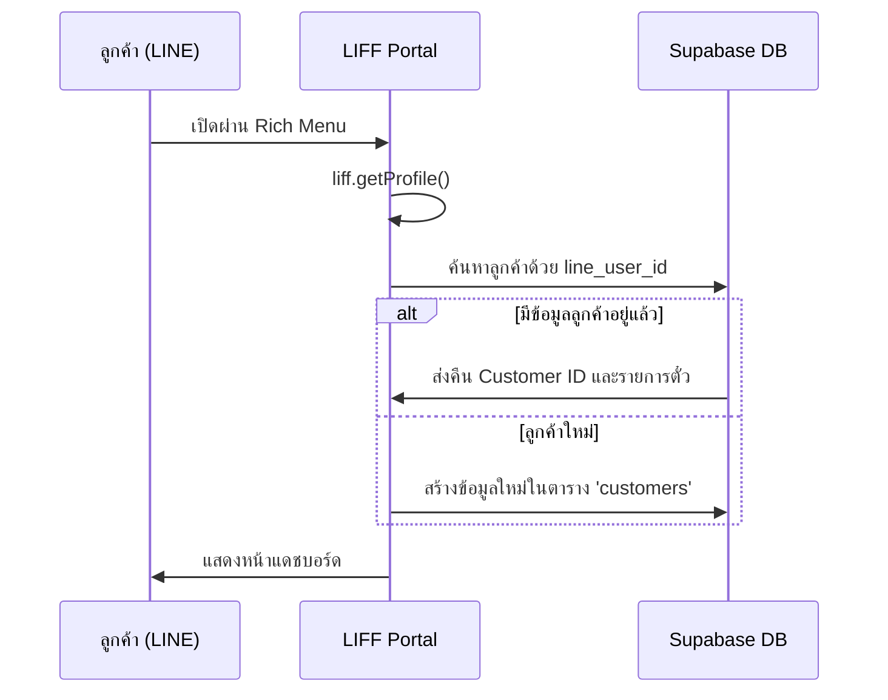

# คู่มือทางเทคนิค: LIFF Customer Status Portal

## 📋 ภาพรวม
**LIFF Customer Status Portal** คือหน้าเว็บอินเทอร์เฟซแบบ Mobile-first ที่รวมอยู่ใน LINE OA ผ่านระบบ **LINE Front-end Framework (LIFF)**
ช่วยให้ลูกค้าสามารถ:
1.  **ดูและติดตามสถานะตั๋วการสนับสนุน (Support Tickets)** โดยไม่ต้องโต้ตอบกับเจ้าหน้าที่โดยตรง
2.  **อัปเดตสถานะผ่าน Timeline** (Log ความคืบหน้า) แบบภาพที่เข้าใจง่าย
3.  **อัปเดตข้อมูลโปรไฟล์** โดยดึงข้อมูลจาก LINE อัตโนมัติ

---

## 🛠️ สถาปัตยกรรม (Architecture)
- **Framework**: Next.js 14+ (App Router)
- **Authentication**: การจับคู่โปรไฟล์ผ่าน LINE LIFF v2
- **Data Sync**: ลูกค้าจะถูกเชื่อมโยงด้วย `line_user_id` ใน Supabase
- **เส้นทาง (Routes)**:
    - `/portal`: แดชบอร์ดหลักสำหรับลูกค้า
    - `/portal/tickets/[id]`: หน้าติดตามสถานะตั๋วรายรายการ

---

## ⚙️ การตั้งค่า (ขั้นตอนทีละขั้น)

### 1. การตั้งค่าใน LINE Developers Console
1.  **สร้าง Provider**: เลือก Provider เดิมที่มีอยู่หรือสร้างใหม่
2.  **สร้าง Messaging API Channel**: นี่คือบัญชี LINE Official Account ของคุณ
3.  **สร้าง LIFF App**:
    - เลือก Provider > สร้างช่องทาง **LIFF** (LIFF channel)
    - **Endpoint URL**: `https://your-domain.com/portal`
    - **Scope**: `profile`, `openid`
    - **Bot link feature**: ตั้งค่าเป็น `On (Normal)` เพื่อให้ระบบแนะนำให้ผู้ใช้เพิ่มบอทเป็นเพื่อน
    - คัดลอก **LIFF ID** (เช่น `2001234567-abcdefgh`)

### 2. ตัวแปรสภาพแวดล้อม (Environment Variables)
เพิ่มค่าต่อไปนี้ในไฟล์ `.env.local` หรือในสภาพแวดล้อมการทำงานจริง (Production):
```bash
# การตั้งค่า LIFF
NEXT_PUBLIC_LIFF_ID=your_liff_id_here
NEXT_PUBLIC_LINE_BOT_ID=@your_line_oa_id # (ไม่บังคับ) สำหรับการเชื่อมโยงบอท
```

### 3. การรวมเข้ากับ Rich Menu (LINE OA Manager)
- ไปที่ [LINE Official Account Manager](https://manager.line.biz/)
- เลือก **หน้าหลัก** > **เครื่องมือห้องแชท** > **ริชเมนู (Rich Menus)**
- สร้างเมนูใหม่และเพิ่มปุ่มด้วยคุณสมบัติดังนี้:
    - **ประเภทของแอ็กชัน**: ลิงก์ (Link)
    - **URL**: `https://liff.line.me/your_liff_id_here`
    - **ป้ายกำกับ (Label)**: ตรวจสอบสถานะงาน (Check Status)

---

## 🔒 ความปลอดภัยและมิดเดิลแวร์ (Security & Middleware)
เส้นทางภายใต้ `/portal`, `/survey`, และ `/api/line` ได้รับการอนุญาตใน `middleware.ts` เพื่อให้สามารถเข้าถึงผ่าน Messaging API และ LIFF ได้
- **LIFF Auth Hook**: `src/hooks/useLiff.ts` จัดการการเริ่มต้นระบบ (initialization) และซิงค์ข้อมูลโปรไฟล์ LINE กับตาราง `customers` ใน Supabase

---

## 🔄 ตรรกะการซิงค์ข้อมูล (Data Sync Logic)


---

## 🚧 การแก้ไขปัญหา (Troubleshooting)
1.  **ข้อผิดพลาด LIFF_ID**: ตรวจสอบให้แน่ใจว่าชื่อตัวแปรขึ้นต้นด้วย `NEXT_PUBLIC_` เพื่อให้สามารถเข้าถึงได้จากฝั่ง Client
2.  **Access Denied**: ผู้ใช้ต้องเข้าถึงพอร์ทัลผ่านอุปกรณ์มือถือหรือแอป LINE Desktop เพื่อให้ `liff.init()` ทำงานสำเร็จ
3.  **ข้อผิดพลาด Supabase Auth**: ตรวจสอบให้แน่ใจว่าตาราง `customers` ในฐานข้อมูลมีการตั้งค่า RLS (Row Level Security) ที่ถูกต้อง เพื่ออนุญาตให้ผู้ใช้ทั่วไป (anonymous) ที่มี LINE `userId` ที่ถูกต้องสามารถอ่าน/เขียนข้อมูลของตนเองได้

---
**สถานะ**: กำลังใช้งานและติดตั้งแล้ว (ACTIVE & IMPLEMENTED)
**ผู้ดูแล**: Antigravity AI
