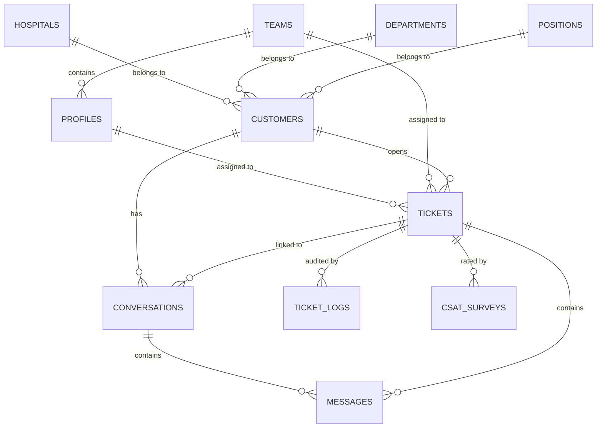

# 🗄️ คู่มือการออกแบบฐานข้อมูล (Database Design Manual)

คู่มือนี้อธิบายโครงสร้าง สถาปัตยกรรม และความสัมพันธ์ของข้อมูลในระบบ **NeoSupport Intelligence Suite**

---

## 🏗️ 1. ภาพรวมสถาปัตยกรรม (Architecture Overview)
ระบบใช้ **PostgreSQL (Supabase)** เป็นฐานข้อมูลหลัก โดยเน้นการออกแบบแบบ **Relational Database** ที่มีความเป็นระเบียบ (Normalized) และใช้ **UUID** เป็นคีย์หลักทั้งหมดเพื่อความปลอดภัยและความยืดหยุ่น

### **แผนผังความสัมพันธ์ (ER Diagram)**

---

## 📋 2. รายละเอียดตารางหลัก (Core Tables)

### **กลุ่มงานบริการ (Ticket Domain)**
| ตาราง | คำอธิบาย | ฟิลด์สำคัญ |
| :--- | :--- | :--- |
| `tickets` | ข้อมูลใบงานหลัก | `ticket_no`, `status`, `priority`, `subject`, `sla_due_at` |
| `conversations` | ห้องแชทที่ผูกกับใบงาน | `customer_id`, `status` (active/closed), `current_ticket_id` |
| `messages` | ข้อความแชททั้งหมด | `content`, `sender_type` (agent/customer/system), `message_type` |

### **กลุ่มผู้ใช้งาน (User Domain)**
| ตาราง | คำอธิบาย | ฟิลด์สำคัญ |
| :--- | :--- | :--- |
| `profiles` | ข้อมูลพนักงาน (Staff) | `full_name`, `role` (Admin/Agent), `permissions` (JSONB) |
| `customers` | ข้อมูลลูกค้า (LINE User) | `line_user_id`, `display_name`, `hospital_id` |
| `teams` | ทีมสนับสนุน | `name`, `manager_id`, `color_code` |

---

## 🛠️ 3. มาตรฐานการออกแบบ (Design Standards)

1.  **Naming Convention:**
    *   ชื่อตารางและคอลัมน์ใช้ `snake_case` (ตัวเล็กทั้งหมด แยกด้วย underscore)
    *   ตารางเป็นพหูพจน์ (เช่น `tickets`, `messages`)
2.  **Timestamps:**
    *   ทุกตารางต้องมี `created_at` และ `updated_at` โดยใช้ประเภท `TIMESTAMPTZ` (Timestamp with Timezone)
3.  **Soft Delete:**
    *   Master Data (เช่น Hospitals) จะใช้คอลัมน์ `is_active` (BOOLEAN) แทนการลบข้อมูลจริง เพื่อรักษา Integrity ของข้อมูลย้อนหลัง
4.  **Auditing:**
    *   การเปลี่ยนแปลงสถานะใบงานจะถูกบันทึกลงใน `ticket_logs` โดยอัตโนมัติผ่าน Database Trigger

---

## 🚀 4. ข้อแนะนำสำหรับนักพัฒนา (Developer Tips)

*   **อย่าใช้ `SELECT *`:** ควรระบุชื่อคอลัมน์ที่ต้องการเสมอเพื่อประสิทธิภาพ
*   **JSONB Usage:** ใช้คอลัมน์ประเภท `JSONB` (เช่นใน `profiles.permissions`) สำหรับข้อมูลที่มีโครงสร้างไม่แน่นอนหรือไม่ต้องการการ Query ซับซ้อน
*   **Indexing:** หากมีการเพิ่มฟิลด์ใหม่ที่ต้องถูก Filter หรือ Sort บ่อยๆ อย่าลืมสร้าง `INDEX` ในฟิลด์นั้นด้วย

---
*จัดทำโดย: Database Specialist Agent (NeoSupport Intelligence Suite)*
