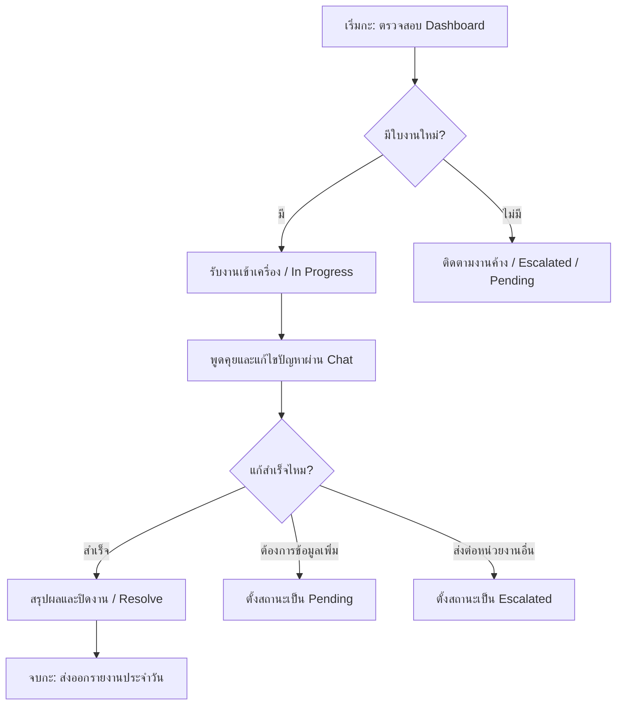

# 🚀 คู่มือการใช้งาน NeoSupport Intelligence Suite (Step-by-Step)

คู่มือฉบับนี้สรุปขั้นตอนการทำงานมาตรฐาน (SOP) สำหรับเจ้าหน้าที่ผู้ดูแลระบบ ตั้งแต่เริ่มกะจนถึงสรุปผลงานประจำวันครับ

---

## 🏗️ 1. แผนผังลำดับงาน (Workflow Overview)

---

## 📅 Step 1: การเริ่มกะและตรวจสอบภาพรวม (Daily Kick-off)
**เป้าหมาย:** เพื่อดูปริมาณงานและลำดับความสำคัญของปัญหา

1.  **เข้าหน้าแดชบอร์ด:** ตรวจสอบค่า **"ใบงานใหม่ (New Tickets)"** หากมีตัวเลขให้รีบเข้าไปจัดการ
2.  **ตรวจสอบงานค้าง:** ดูช่อง **"ส่งต่อ (Escalated)"** และ **"รอดำเนินการ (Pending)"** เพื่อติดตามสถานะล่าสุด
3.  **สังเกตแนวโน้ม:** ดูพิกัด Ticket Trend เพื่อเตรียมตัวรับมือหากมีปริมาณงานพุ่งสูงขึ้น

---

## 📥 Step 2: การรับและจัดการใบงาน (Handling Tickets)
**เป้าหมาย:** เปลี่ยนสถานะงานจาก "งานใหม่" เป็น "กำลังดำเนินการ"

1.  ไปที่เมนู **"จัดการใบงาน (Ticket Workspace)"**
2.  **เลือก Filter เวลา:** แนะนำให้เลือก **"วันนี้"** หรือ **"สัปดาห์นี้"**
3.  **เลือกรับงาน:** 
    *   กดที่ใบงานในช่อง **New**
    *   ตรวจสอบรายละเอียดเบื้องต้น (โรงพยาบาล, หัวข้อปัญหา)
    *   กดปุ่ม **"รับงาน"** เพื่อย้ายใบงานเข้าสู่ช่อง **In Progress**

---

## 💬 Step 3: การสนทนาและแก้ไขปัญหา (Resolution Process)
**เป้าหมาย:** สื่อสารกับลูกค้าและแก้ไขปัญหาให้จบ

1.  คลิกที่ไอคอน **"แชท"** ในใบงานเพื่อเปิดห้องสนทนา LINE
2.  **แก้ไขปัญหา:** พูดคุยและส่งรูปภาพ/ไฟล์ประกอบผ่านหน้าแชท
3.  **จัดการสถานะพิเศษ (หากยังปิดงานไม่ได้):**
    *   **Pending:** หากต้องรอเครื่องมือหรือรอข้อมูลจากลูกค้า
    *   **Escalated:** หากต้องส่งต่อให้โปรแกรมเมอร์หรือทีมบริหาร

---

## ✅ Step 4: การสรุปผลและปิดใบงาน (Closing Tickets)
**เป้าหมาย:** บันทึกวิธีแก้ไขและเปลี่ยนสถานะเป็นสำเร็จ

1.  เมื่อแก้ไขปัญหาเสร็จ ให้กดปุ่ม **"ปิดงาน (Resolve)"**
2.  **บันทึกข้อมูลสำคัญ:**
    *   **Module:** ระบุระบบที่พบปัญหา (เช่น สิทธิการรักษา, ระบบคิว)
    *   **Resolution:** พิมพ์สรุปสั้นๆ ว่าแก้ไขอย่างไร (ข้อมูลนี้จะไปอยู่ในรายงาน)
3.  **ตรวจสอบความเรียบร้อย:** ใบงานจะย้ายไปอยู่ในช่อง **Resolved** โดยอัตโนมัติ

---

## 📈 Step 5: การส่งรายงานประจำวัน (End of Day Reporting)
**เป้าหมาย:** สรุปผลงานส่งให้ทีมบริหาร

1.  ไปที่เมนู **"รายงานประจำวัน (Daily Report)"**
2.  **ตรวจสอบข้อมูล:** ดูเวลาที่ใช้ (เช่น `1 ชม. 30 น.`) ว่าถูกต้องสมเหตุสมผลหรือไม่
3.  **ปรับแต่งตาราง:** ลากปรับความกว้างคอลัมน์ให้เห็นข้อมูลครบถ้วน
4.  **ส่งออกรายงาน:** กดปุ่ม **"ส่งออกรายงาน"** เพื่อรับไฟล์ Excel หรือ PDF เพื่อส่งเข้ากลุ่ม LINE ต่อไป

---
> **💡 TIP:** สำหรับเจ้าหน้าที่ใหม่ หากไม่แน่ใจขั้นตอน สามารถถาม AI โดยอ้างอิงคู่มือฉบับนี้ได้ทันทีครับ!
