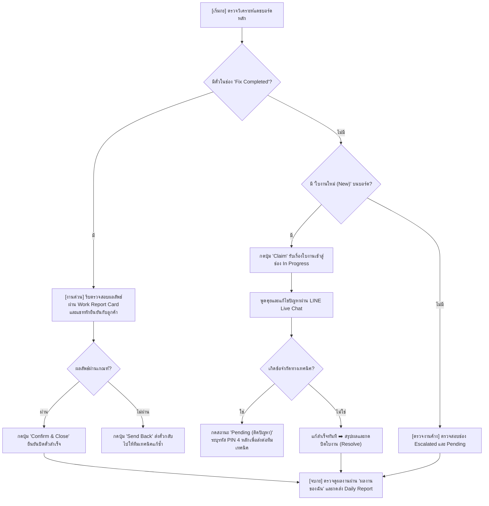

# 🚀 คู่มือปฏิบัติการระบบ NeoSupport Intelligence Suite (Step-by-Step SOP)
*คู่มือปฏิบัติการฉบับทางการสำหรับเจ้าหน้าที่และผู้บริหารรายใหม่ (Dark-Mode Glassmorphic Premium Edition)*

คู่มือปฏิบัติการฉบับนี้รวบรวมขั้นตอนการทำงานมาตรฐาน (Standard Operating Procedure: SOP) ของระบบ **NeoSupport** โดยแสดงลำดับขั้นตอนการปฏิบัติงานจริงในแต่ละวันอย่างละเอียดตั้งแต่ต้นจนจบกะ พร้อมการฝังภาพประกอบ UI จริง เพื่อช่วยให้เจ้าหน้าที่ทุกคนทำงานได้อย่างถูกต้อง รวดเร็ว และเป็นมืออาชีพทันทีในวันแรก!

---

## 🏗️ 1. แผนผังลำดับกระบวนการทำงานมาตรฐาน (Standard Workflow)

ในการปฏิบัติงานประจำกะ ตารางงานของคุณจะไหลไปตามทิศทางกระบวนการประสานงาน (SLA Flow) ด้านล่างนี้:

---

## 📅 Step 1: การเริ่มกะและตรวจภาพรวมระบบ (Daily System Check)
**เป้าหมาย:** เพื่อประเมินปริมาณงาน ลำดับความสำคัญ และตรวจหาสถานการณ์วิกฤตก่อนเริ่มต้นทำงานจริง

### 🛠️ ขั้นตอนปฏิบัติ:
1.  **เข้าสู่หน้าแดชบอร์ดหลัก (Executive Overview):** 
    *   สังเกตการ์ดตัวเลขสถิติรวม 4 แถวหลัก (สีเขียวมรกตและสีฟ้านีออน) เพื่อวิเคราะห์ความหนาแน่นของงานในรอบวัน
2.  **ประเมินใบงานใหม่ (New Tickets):**
    *   ดูตัวเลขบนการ์ด **"ใบงานใหม่"** หากตัวเลขมากกว่า 0 หมายความว่ามีเคสลูกค้าทักเข้ามาและยังไม่มีใครรับเรื่อง ให้เตรียมตัวเข้าไปเคลมใบงานในขั้นตอนถัดไป
3.  **ติดตามเคสวิกฤต (Urgent Alert Check):**
    *   ตรวจสอบแถบสีแดงกระพริบ **"ส่งต่อ (Escalated)"** และแถบสีส้มทอง **"รอดำเนินการ (Pending)"** ด้านล่างแดชบอร์ด 
    *   หากมีตั๋วคงค้าง ให้จดรหัสตั๋วไว้เพื่อเข้าตรวจสอบสถานะต่อ เนื่องจากเป็นงานเร่งด่วนที่ส่งผลต่อดัชนีชี้วัดความเร็ว (SLA Target) ของระบบ

---

## 📥 Step 2: การคัดกรองและเคลมรับใบงาน (Ticket Workspace Operations)
**เป้าหมาย:** รับผิดชอบตั๋วใหม่เข้าระบบ เปลี่ยนสถานะตั๋วจากงานรอคอย (New) เข้าสู่ระบบปฏิบัติการของคุณ (In Progress)

### 🛠️ ขั้นตอนปฏิบัติ:
1.  **เปิดเมนู Operations ➡️ จัดการใบงาน:**
    *   คุณจะพบกระดาน Kanban Board แบ่งคอลัมน์สีสันเรืองแสงชัดเจน (ไม่มีการใช้สีม่วง/ชมพูตามกฎแบรนด์พรีเมียม)
2.  **ปรับตัวกรองช่วงเวลา (Time Filter):**
    *   เลือกปุ่มด้านบนเป็น **"วันนี้"** เพื่อคัดกรองเฉพาะปัญหาที่เกิดในกะปัจจุบัน หรือเลือก **"สัปดาห์นี้"** เพื่อดูประวัติย้อนหลัง
3.  **เคลมใบงานใหม่เข้าระบบ (Claiming Ticket):**
    *   คลิกการ์ดงานที่ค้างอยู่ในช่อง **New** เพื่อเปิดดูรายระเอียดเบื้องต้น (เช่น ชื่อโรงพยาบาล, แท็กปัญหา)
    *   กดปุ่ม **"รับงาน (Claim Job)"** การ์ดจะไหลย้ายไปอยู่ในช่อง **In Progress (กำลังดำเนินการ)** อัตโนมัติ พร้อมบันทึกชื่อคุณเป็นผู้ดูแลรับผิดชอบหลักทันที

---

## 🔄 Step 3: ระบบจัดการงานแก้ไขเชิงเทคนิค (Pending & Fix Completed Workflow)
**เป้าหมาย:** ประสานงานส่งต่อให้โปรแกรมเมอร์แก้ไขงานระบบหลังบ้าน และทำการตรวจสอบผลลัพธ์ผ่าน Work Report Card

> [!NOTE]
> ระบบนี้ได้รับการอัปเกรดเพื่อป้องกันไม่ให้เจ้าหน้าที่ฝ่ายซัพพอร์ตต้องแบกรับ SLA เคสที่เกิดจากบั๊กของระบบ (System Bug) ที่ควบคุมไม่ได้ โดยเจ้าหน้าที่หลักและทีมเทคนิคภายนอกจะปฏิบัติงานร่วมกันผ่านกระบวนการนี้

### 🛠️ ขั้นตอนปฏิบัติ:

#### 🧑‍💼 3.1 การส่งต่อปัญหาไปยังทีมโปรแกรมเมอร์ (Support ➡️ Pending)
1.  ในตั๋วที่คุณดูแลอยู่ หากพบว่าเกิดจากข้อบกพร่องระบบที่ไม่สามารถกดแก้เองได้ ให้กดปุ่มสถานะ **"ติดปัญหา (Pending)"**
2.  ระบบจะทำการจับคู่ตั๋วและ **สุ่มรหัส PIN 4 หลัก** (เช่น `8549`) แสดงขึ้นบนหน้าจอของคุณ ให้คุณคัดลอกลิงก์งานส่งต่อพร้อมแจ้งรหัส PIN นี้ให้ทีมโปรแกรมเมอร์รับทราบ
3.  ตั๋วจะย้ายไปคอลัมน์ **Pending** ทันที และระบบจะหยุดจับเวลา SLA ของคุณชั่วคราวเพื่อรักษาสถิติ

#### 👨‍💻 3.2 การแก้ไขและส่งกลับมาให้ซัพพอร์ต (Handler ➡️ Fix Completed)
1.  ทีมเทคนิคคลิกลิงก์เคสและป้อนรหัส PIN 4 หลักเพื่อปลดล็อกเข้ารายงาน
2.  เมื่อทีมเทคนิคแก้ไขโปรแกรมเสร็จสิ้น จะทำการป้อนบันทึกวิเคราะห์สาเหตุ (Technical Notes) พร้อมระบุสถานะขาส่งกลับเป็น **"Fix Completed"**
3.  ตั๋วใบนี้จะไหลออกจากคอลัมน์ Pending สีแดง และเข้ามาปรากฏที่ **คอลัมน์สีฟ้าเรืองแสงเด่นชัด "Fix Completed"** บนหน้าจอซัพพอร์ตโดยอัตโนมัติ!

#### 🧑‍💼 3.3 การตรวจสอบรายละเอียดแบบพรีเมียม (Support Review)
1.  ให้คลิกการ์ดตั๋วที่ค้างอยู่ในคอลัมน์ **Fix Completed**
2.  แถบขวาจะแสดงหน้าต่าง **Work Report Card** ดีไซน์กระจกฝ้าหรูหรา แสดงบันทึกและสถิติเวลาของโปรแกรมเมอร์
3.  ทำการกดปุ่มตรวจสอบที่เหมาะสมบริเวณแถบหัวตั๋วด้านบน:
    *   🟢 **Confirm & Close (ยืนยันผลและปิดงาน):** กดปุ่มนี้ทันทีหากคุยประสานงานและตรวจผลระบบย่อยแล้วว่าปัญหาหายขาดจริง ตั๋วจะปิดเป็น **Resolved** เรียบร้อย
    *   🟠 **Send Back to Edit (ส่งกลับไปแก้ใหม่):** กดปุ่มนี้พร้อมเขียนโน้ตเพิ่มเติมหากทดสอบแล้วบั๊กยังคงอยู่ ตั๋วจะเด้งกลับไปคอลัมน์ **Pending** เพื่อให้ทีมโปรแกรมเมอร์รับไปดำเนินการซ่อมต่อทันที

---

## 💬 Step 4: การสื่อสารลูกค้าและการจบสนทนา (LINE Live Chat Operations)
**เป้าหมาย:** สื่อสารประสานงานกับผู้ใช้ผ่านหน้าต่างแชท LINE OA อย่างถูกต้อง และปิดกะแชทอย่างปลอดภัย

### 🛠️ ขั้นตอนปฏิบัติ:
1.  **การตอบสนทนากับลูกค้า:**
    *   เมื่อตั๋วถูกผูกกับไลน์ลูกค้า ให้ไปที่เมนู **ห้องแชทลูกค้า** คลิกเลือกรายชื่อลูกค้าด้านซ้ายเพื่อพิมพ์พูดคุย สอบถามรายละเอียดเพิ่มเติม หรือขอรูปภาพประกอบปัญหา
2.  **พฤติกรรมห้องแชทในระยะตรวจสอบ (Fix Completed State):**
    *   *สำคัญมาก:* เมื่อตั๋วถูกส่งกลับเข้ามาอยู่ที่คอลัมน์ **Fix Completed** ห้องแชทนี้ **จะยังเปิดคงค้างไว้เสมอ** เจ้าหน้าที่ต้องพิมพ์ทักแชทบอกลูกค้าว่าระบบได้รับการแก้ไขแล้ว และกระตุ้นให้ลูกค้ากดทดสอบระบบย่อยของตนเอง
3.  **การจบกะสนทนาด้วยตนเอง (Manual End Chat):**
    *   เมื่อคุยทดสอบจนได้รับการยืนยันพึงพอใจจากลูกค้า ให้เจ้าหน้าที่กดปุ่ม **"End Chat"** (ปุ่มกระจกฝ้าขอบสีแดงส้มเรืองแสงบริเวณมุมขวาบนของแถบโปรไฟล์ลูกค้า) 
    *   การกดปุ่มนี้เป็นการยืนยันความปลอดภัยของระบบในการยุติคิวแชทเดิม เพื่อลดภาระหน้าจอทำงานและพร้อมรับเคสของลูกค้ารายใหม่ในกะถัดไป

---

## 📈 Step 5: การสรุปประเมินผลงานและส่งรายงานประจำวัน (Reporting & Analytics)
**เป้าหมาย:** ติดตามเป้าหมายผลงานส่วนบุคคล และส่งออกไฟล์สรุปยอดใบงานการแก้ไขส่งให้หัวหน้าทีม

### 🛠️ ขั้นตอนปฏิบัติ:
1.  **ประเมินแนวโน้มผลงานที่เมนู Intelligence ➡️ ผลงานของฉัน (`/analytics/personal`):**
    *   **ดูแผนภูมิพื้นที่ (Area Chart):** แสดงปริมาณการแก้ไขเสร็จสิ้นรายวันของคุณ (สีเขียว/ฟ้านีออนตัดกัน) 
    *   **ตรวจสอบเปอร์เซ็นต์ตีกลับ (Rework Rate):** ตรวจสอบว่ามีปริมาณงานถูกกดตีกลับกี่เปอร์เซ็นต์ เพื่อพยายามปรับปรุงความละเอียดของงานซ่อมบำรุง
2.  **เข้าเมนู Intelligence ➡️ รายงานประจำวัน (Daily Report):**
    *   ตารางสรุปตั๋วของวันนี้จะปรากฏขึ้นพร้อมฟังก์ชันการประมวลผลข้อมูลขั้นสูง
3.  **ปรับแต่งตารางตามความต้องการใช้งานจริง (Interactive Grid):**
    *   **การปรับความกว้างคอลัมน์ (Column Resizing):** นำเมาส์ไปวางที่เส้นขอบแบ่งหัวคอลัมน์ ดับเบิ้ลคลิกหรือลากเพื่อปรับขนาดความกว้างตามความยาวของข้อความบันทึก (Resolution Text) ได้ทันที
    *   **การอ่านค่าตัวย่อเวลา:** สังเกตการแสดงผลย่อที่อ่านง่ายกระชับ (เช่น `1 ชม. 45 น.`, `12 น.`) เพื่อวิเคราะห์ว่าใช้เวลาเฉลี่ยตามเกณฑ์มาตรฐานหรือไม่
4.  **การส่งออกรายงาน (Exporting):**
    *   คลิกปุ่ม **"ส่งออกรายงาน"** ด้านบนสุด เพื่อทำการสร้างและดาวน์โหลดไฟล์สรุปประจำกะในรูปแบบ PDF หรือ Excel นำไปส่งเข้ากลุ่มสรุปงานไลน์ผู้บริหารตามกำหนดเวลาจบกะ

---

## ⚙️ Step 6: การจัดการความปลอดภัยและตั้งค่าสิทธิ์พนักงาน (Staff & Security Permissions)
**เป้าหมาย:** เพื่อควบคุมสิทธิ์ในการดูข้อมูลเชิงลึกและการวิเคราะห์พนักงานเฉพาะผู้ได้รับสิทธิ์ที่กำหนดโดยแอดมินหลัก

### 🔐 การตั้งค่าสิทธิ์เข้าถึงเมนูใหม่ในหน้า "จัดการพนักงาน":
หากคุณเป็นเจ้าหน้าที่ระดับแอดมินสูงสุด (Administrator) และต้องการกำหนดสิทธิ์ให้กับพนักงานเข้าทำหน้าที่ในระบบ ให้เข้าไปที่เมนู **System ➡️ จัดการพนักงาน** เลือกแก้ไขพนักงาน และสลับสิทธิ์การเข้าถึงให้ตรงกับลักษณะงาน:

*   🟢 **สิทธิ์ดูสถิติพนักงานทั้งหมด (`analytics_staff`):**
    *   *ข้อควรระวัง:* แนะนำให้สลับเป็น **"ปิด"** สำหรับพนักงานระดับปฏิบัติการ (Agent) ทั่วไป และให้ **"เปิด"** เฉพาะผู้บริหารหรือหัวหน้าทีมเท่านั้น เพื่อรักษาความลับส่วนบุคคลด้านตัวชี้วัดประสิทธิภาพ
*   🟢 **สิทธิ์ดูรายงานผลงานตนเอง (`analytics_personal`):**
    *   แนะนำให้ **"เปิด"** เสมอสำหรับซัพพอร์ตซ่อมบำรุงทุกคน เพื่อให้สามารถเข้ามาท้าทายเป้าหมายและวิเคราะห์ข้อบกพร่องงานของตนเองเพื่อพัฒนาฝีมือได้อย่างต่อเนื่อง

---

## 💡 สรุปทางลัดการจำขั้นตอนปฏิบัติสำหรับพนักงานใหม่ (Fast-Track Flow Summary)

1. **เช้ากะ:** ส่องแดชบอร์ด ดูเคสใหม่ค้าง ➡️ เคลมใบงานใน Workspace เข้าคอลัมน์ `In Progress`
2. **ระหว่างกะ:** ทักคุยช่วยเหลือผู้ใช้ใน `LINE Live Chat` ➡️ ส่งต่อปัญหาบั๊กเชิงเทคนิคที่แก้ไม่ได้ไปคอลัมน์ `Pending` (ใส่รหัส PIN 4 หลัก)
3. **ตรวจสอบตั๋วแก้ไขเสร็จ:** เช็คคอลัมน์ `Fix Completed` ➡️ คลิกตรวจสอบ **Work Report Card** แถบขวา ➡️ ทักแชทให้ลูกค้าลองระบบ ➡️ ลูกค้าผ่าน ➡️ กด **Confirm & Close** ปิดงาน
4. **ท้ายกะ:** ส่องกราฟเมนู **ผลงานของฉัน** ➡️ ไปหน้า **รายงานประจำวัน** ➡️ ลากความกว้างช่องตารางให้เรียบร้อย ➡️ กด **ส่งออกรายงาน** จบกะงานอย่างสมบูรณ์แบบ!

---
*จัดทำขึ้นและใช้เป็นมาตรฐานปฏิบัติงานของเจ้าหน้าที่ภายในระบบ NeoSupport Intelligence Suite เท่านั้น*
