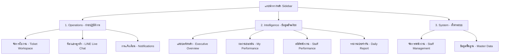

# 📘 คู่มือการใช้งานระบบ NeoSupport Intelligence Suite (Premium Staff Edition)

ยินดีต้อนรับสู่ระบบจัดการปัญหาอัจฉริยะ **NeoSupport Intelligence Suite** ระบบปฏิบัติการและวิเคราะห์ข้อมูลระดับพรีเมียมที่ขับเคลื่อนด้วยดีไซน์แบบ **Dark-Mode Glassmorphism (HUD Style)** ที่ให้ความรู้สึกพรีเมียม ล้ำสมัย และจัดระเบียบข้อมูลได้อย่างมีประสิทธิภาพสูงสุด คู่มือฉบับนี้จัดทำขึ้นโดยละเอียดเพื่อให้เจ้าหน้าที่และผู้บริหารรายใหม่สามารถอ่าน ทำความเข้าใจ และปฏิบัติตามเพื่อเริ่มต้นใช้งานระบบได้ทันที!

---

## 🧭 1. ภาพรวมโครงสร้างเมนูและการนำทาง (System Navigation Map)

แถบเมนูหลักด้านซ้าย (Sidebar) ถูกจัดกลุ่มออกเป็น 3 โมดูลหลักตามบทบาทหน้าที่ในการทำงานอย่างชัดเจน:



### 💎 รูปแบบและแนวคิดการดีไซน์ของระบบ (UI Design Guidelines)
*   **ธีมสีหลัก (Color Palette):** เน้นโทนสีเข้ม (Dark Slate) ตัดด้วยปุ่มควบคุมและสถานะเรืองแสง ได้แก่ **สีเขียวมรกต (Emerald Green)** สำหรับงานสำเร็จ, **สีส้มอำพัน (Amber Gold)** สำหรับงานกำลังดำเนินการ/ติดปัญหา และ **สีฟ้านีออน (Cyan Blue)** สำหรับระบบงานแก้ไขเสร็จสิ้น *(ระบบนี้ไม่มีการใช้โทนสีม่วง/ชมพูโดยเด็ดขาดเพื่อความเป็นสากลและพรีเมียมสูงสุด)*
*   **ความโค้งมนและขอบตาราง (Geometry):** ใช้ดีไซน์ขอบเหลี่ยมคมตัดเฉียบพรีเมียม (Sharp edges: 0px - 2px) สำหรับกระดานข้อมูลเชิงลึก และใช้เอฟเฟกต์กระจกฝ้า (Frosted Glass backdrop blur) ซ้อนมิติในการซูมดูรายละเอียด

---

## 📊 2. แดชบอร์ดและสถิติสะสม (Executive Dashboard)

หน้าจอแรกที่คุณจะพบเมื่อเข้าสู่ระบบ ได้รับการออกแบบมาเพื่อช่วยให้ผู้บริหารและหัวหน้าทีมสามารถอ่านภาพรวมสถานะการทำงานได้อย่างรวดเร็วภายใน 3 วินาที


### 📊 การอ่านค่าสถิติหลัก (Core KPIs):
1.  **ใบงานวันนี้ (Today's Tickets):** จำนวนใบงานที่ถูกเปิดเข้ามาในรอบ 24 ชั่วโมงที่ผ่านมา พร้อมตัวเลขเปอร์เซ็นต์บ่งชี้ว่าสูงขึ้นหรือต่ำลงเมื่อเปรียบเทียบกับสัปดาห์ก่อนหน้า
2.  **ใบงานใหม่ (New):** (การ์ดเรืองแสงสีฟ้านีออน) จำนวนใบงานที่ส่งเข้ามาจากลูกค้าและยังไม่มีเจ้าหน้าที่รับดำเนินการ
3.  **กำลังดำเนินงาน (In Progress):** (การ์ดเรืองแสงสีส้มอำพัน) จำนวนใบงานที่เจ้าหน้าที่กดเคลมรับเรื่องเข้าระบบแล้ว และกำลังอยู่ในกระบวนการตรวจสอบ
4.  **ปิดงานแล้ว (Resolved):** (การ์ดเรืองแสงสีเขียวมรกต) จำนวนเคสที่สรุปการแก้ไขสำเร็จและกดยืนยันปิดงานเรียบร้อยแล้ว

### ⚠️ แผงสถานะและงานเร่งด่วนพิเศษ (Urgency Alerts Panel):
*   **ส่งต่อ (Escalated):** (แถบแจ้งเตือนสีแดงสด) จำนวนเคสที่มีข้อจำกัดเชิงเทคนิคจนต้องส่งต่อไปยังทีมผู้เชี่ยวชาญภายนอก (Developer/System Engineer) และยังไม่ถูกส่งกลับมา
*   **รอดำเนินการ (Pending):** (แถบแจ้งเตือนสีเหลืองทอง) เคสที่รับทราบปัญหาแล้ว แต่กำลังหยุดจับเวลา SLA ชั่วคราวเพื่อรอข้อมูลเพิ่มเติมจากผู้ใช้บริการหรือรออะไหล่ทดสอบ

---

## 📋 3. กระดานจัดการใบงานและระบบส่งต่อ (Ticket Workspace & Fix Completed)

เมนู **Operations ➡️ จัดการใบงาน** คือหน้าต่างปฏิบัติงานหลักของทีมเจ้าหน้าที่ โดยจัดรูปแบบบอร์ดในสไตล์ **Kanban Board** เพื่อให้เห็นการไหลของงานจากซ้ายไปขวา


### 🔄 แนะนำแท่นควบคุม "Fix Completed" (ขั้นตอนตรวจสอบโดยละเอียด):

เมื่อผู้รับงานภายนอก (เช่น โปรแกรมเมอร์) แก้ไขปัญหาเสร็จสิ้น ตั๋วจะถูกเด้งเข้ามาที่คอลัมน์สีฟ้าเรืองแสง **"Fix Completed (แก้ไขเสร็จสิ้น)"** อัตโนมัติ:

1.  **การดูการ์ดสรุปงาน (Work Report Card):** เมื่อเจ้าหน้าที่คลิกที่ตั๋วในคอลัมน์นี้ แถบขวาจะแสดงหน้าต่างการ์ดกระจกฝ้าเรืองแสง แสดงผลลัพธ์การแก้ไข เช่น บันทึกรหัสการอัปเดตเวอร์ชัน รูปภาพหลักฐานการทดสอบ และสรุปเวลารวมที่ใช้แก้ไข
2.  **ปุ่มควบคุมผลการตรวจสอบ (Review Control Buttons):** ด้านบนสุดของการ์ดรายงานจะมีปุ่มควบคุมแบบโปร่งแสง 2 ปุ่ม:
    *   🟢 **ยืนยันผลและปิดงาน (Confirm & Close):** ให้กดปุ่มนี้ทันทีหากคุณทำการทดสอบระบบย่อยแล้วพึงพอใจและตรวจสอบกับลูกค้าผ่านแชทเรียบร้อย ตั๋วจะย้ายไปคอลัมน์ "resolved" และระบบจะบันทึกสถานะลงฐานข้อมูลถาวร
    *   🟠 **ส่งกลับไปแก้ไขใหม่ (Send Back to Edit):** หากคุณทดสอบแล้วพบว่าปัญหายังคงอยู่หรือแก้ไขไม่ครบ ให้กดปุ่มนี้เพื่อส่งตั๋วกลับไปสถานะ **Pending** อัตโนมัติ เพื่อให้ผู้แก้รับไปตรวจสอบต่อพร้อมเขียนคำอธิบายเพิ่มเติม

> [!TIP]
> **ระบบคงค้างใบงานติดปัญหา (Sticky Cards Rule):** 
> แม้คุณจะใช้ตัวกรองช่วงเวลา (Time Filter) เช่น "วันนี้" หรือ "สัปดาห์นี้" ตั๋วทุกใบที่อยู่ในคอลัมน์ **Pending (ติดปัญหา)** และ **Fix Completed (แก้ไขเสร็จสิ้น)** จะยังคง **แสดงค้างไว้บนบอร์ดเสมอ** ไม่ถูกซ่อนตามเงื่อนไขเวลา เพื่อป้องกันเจ้าหน้าที่ลืมติดตามงานคงค้างครับ!

---

## 💬 4. ห้องแชทสื่อสารลูกค้า (LINE Live Chat Portal)

เมนู **Operations ➡️ ห้องแชทลูกค้า** คือหน้าต่างประสานงานและพูดคุยแบบ Real-time กับลูกค้าที่ทักเข้ามาผ่านบัญชี LINE OA ของบริษัท


### 🔄 ขั้นตอนการสนทนาและการย้ายสถานะตั๋ว:
1.  **เชื่อมโยงหน้าต่างแชท:** เมื่อลูกค้าทักมา แชทจะมาปรากฏในแผงด้านซ้ายพร้อมเสียงเตือน เจ้าหน้าที่สามารถคลิกเพื่อพิมพ์ตอบโต้ และแนบรูปภาพหรือไฟล์คู่มือการตั้งค่าได้อย่างรวดเร็ว
2.  **พฤติกรรมห้องแชทในสถานะ Fix Completed:** 
    *   เมื่อตั๋วของลูกค้าถูกย้ายไปอยู่ที่สถานะ **"Fix Completed"** หน้าต่างแชทนี้ **จะยังคงเปิดค้างไว้เสมอ** เพื่อให้เจ้าหน้าที่สามารถพิมพ์ทักทายส่งข้อความบอกกล่าวผลการแก้ไข ตลอดจนขอให้ลูกค้าทดสอบก่อนยืนยันปิดเคส
3.  **การจบการสนทนาอย่างสมบูรณ์ (Manual End Chat):** 
    *   หลังจากลูกค้ากดยืนยันหรือตอบกลับว่าปัญหาได้รับการแก้ไขแล้ว ให้เจ้าหน้าที่คลิกที่ปุ่ม **"End Chat" (จบการสนทนา)** (ปุ่มกระจกโปร่งแสงขอบสีแดงส้มเรืองแสงบริเวณมุมขวาบนของโปรไฟล์ลูกค้า) เพื่อทำการเคลียร์คิวและปิดการเชื่อมต่อห้องแชทอย่างปลอดภัย

> [!WARNING]
> **ข้อควรระวังเรื่องค่าบริการ LINE OA:**
> ระบบ NeoSupport ออกแบบมาให้สื่อสารผ่านระบบ **Reply Token** ภายในหน้าต่าง 24 ชม. ของข้อความล่าสุดของลูกค้า ซึ่งจะประหยัดค่าโควต้าส่งข้อความ (Push Message) ของบริษัทได้ 100% พยายามตอบกลับและปิดตั๋วในเวลาดังกล่าวเสมอครับ!

---

## 📈 5. ระบบวิเคราะห์และสถิติประสิทธิภาพ (Performance Analytics)

เมนู **Intelligence ➡️ แดชบอร์ดและสถิติ** และเมนูย่อยประสิทธิภาพ ได้รับการอัปเกรดเพื่อการประเมินคุณภาพงานในระดับบุคคลและภาพรวมทีม


### 🧑‍💻 5.1 ผลงานของฉัน (My Performance Dashboard)
*เมนูเฉพาะเจ้าหน้าที่ผู้ปฏิบัติงานในการประเมินและท้าทายเป้าหมายตนเอง:*
*   **แผนภูมิแนวโน้มส่วนตัว (Area Chart):** แสดงปริมาณงานที่แก้ไขเสร็จสิ้นในแต่ละวันเทียบกับเส้นสถิติเฉลี่ยของทีม (มีสีฟ้าและสีเขียวนีออนตัดกันอย่างสวยงาม)
*   **อัตราส่วนงานตีกลับ (Rework Metric):** รายงานข้อมูลเปรียบเทียบว่าตั๋วที่คุณส่งแก้ไขเสร็จสิ้น ถูกกด "ส่งกลับไปแก้ไขใหม่" บ่อยแค่ไหน ช่วยให้ประเมินความละเอียดของงานตนเองได้
*   **ความรวดเร็วในการแก้ปัญหา (Average SLA Resolution Speed):** คำนวณแบบนาทีต่อนาทีเพื่อแสดงศักยภาพในการแก้ปัญหาแต่ละประเภท

### 👥 5.2 สถิติพนักงาน (Staff Performance Dashboard)
*เมนูสิทธิพิเศษระดับผู้บริหาร/แอดมิน เพื่อการจัดสรรทรัพยากรบุคคล:*
*   **ตัวเลือกรายพนักงาน (Staff Selector Dropdown):** แอดมินสามารถคลิกเพื่อค้นหารายชื่อพนักงานในระบบเพื่อเจาะลึกดูผลงานของพนักงานคนนั้นๆ ได้โดยตรง
*   **แผนภูมิวงกลมกระจายงาน (Staff Ticket Distribution Chart):** แสดงเปอร์เซ็นต์การรับภาระงานของพนักงานแต่ละคนในปัจจุบัน เพื่อช่วยหัวหน้าทีมเกลี่ยปริมาณงานไม่ให้เกิดภาวะคอขวด (Bottleneck)
*   **การวิเคราะห์ SLA Compliance Rate:** แผนภูมิวินัยและการตอบสนอง บ่งชี้จำนวนเคสที่ผ่านและตกเกณฑ์กำหนดเวลาบริการ

---

## ⚙️ 6. ตั้งค่าระบบและสิทธิ์การเข้าถึงเมนู (Staff & Permission Management)

เมนู **System ➡️ จัดการพนักงาน** คือศูนย์กลางควบคุมความปลอดภัยและจัดการผู้ใช้ของระบบ

### 🔐 การกำหนดสิทธิ์เข้าถึงเมนูใหม่แบบละเอียด (Granular Menu Permissions):
ในการอัปเกรดระบบรอบล่าสุด แอดมินหลักสามารถกำหนดความปลอดภัยในการมองเห็นเมนูและฟังก์ชันวิเคราะห์ได้อิสระ โดยเข้าไปที่หน้าต่างแก้ไขข้อมูลพนักงาน (Staff Editor) และสลับตัวเลือกเปิด/ปิดสิทธิ์ ดังนี้:

| ชื่อฟังก์ชันสิทธิ์การใช้งาน | คำอธิบายสิทธิ์และการเข้าถึง | หน้าที่ระดับพนักงานที่แนะนำ |
| :--- | :--- | :--- |
| **`analytics_personal`** | อนุญาตให้เข้าถึงเมนู **ผลงานของฉัน** (`/analytics/personal`) เพื่อดูรายงานกราฟสถิติงานของตนเอง | แนะนำให้เปิดใช้งานสำหรับพนักงานทุกคน (Staff / Agent / Admin) |
| **`analytics_staff`** | อนุญาตให้เข้าถึงเมนู **สถิติพนักงาน** (`/analytics/staff`) เพื่อเจาะลึกดูสถิติและเปรียบเทียบงานของเพื่อนร่วมทีมทั้งหมด | สงวนสิทธิ์สำหรับแอดมินหลัก (Admin) และหัวหน้าฝ่ายปฏิบัติการ (Supervisor) เท่านั้น |

```
[ ] อนุญาตสิทธิ์ส่วนบุคคล (analytics_personal)  ──>  [🟢 สลับเปิดใช้งาน]
[ ] อนุญาตสิทธิ์ดูภาพรวมทีม (analytics_staff)     ──>  [🔴 ปิดการเข้าถึงสำหรับ Agent ทั่วไป]
```

### 📋 6.2 การตั้งค่าข้อมูลพื้นฐาน (Master Data Management)
*   ก่อนเริ่มระบบงานเป็นครั้งแรก แอดมินต้องเข้ามาที่เมนู **ข้อมูลพื้นฐาน (Master)** เพื่อป้อนรายชื่อโรงพยาบาลในเครือ แผนกสนับสนุนหลัก และสร้างแท็กหัวข้อปัญหา (เช่น บั๊กซอฟต์แวร์, ปัญหาฮาร์ดแวร์, การพิมพ์ใบเสร็จ) เพื่อช่วยในการกรองและระบุประเภทตั๋วในภายหลัง

---

## 🚀 7. คู่มือปฏิบัติงานด่วนสำหรับผู้ใช้ใหม่ (First-Day Quickstart Cheat Sheet)

หากวันนี้คือ **วันแรก** ในการเริ่มงานของคุณในฐานะ Support Agent ให้ทำตาม 5 ขั้นตอนนี้ทันที:

```
[ขั้นตอนที่ 1] เข้าระบบและตรวจสอบหน้าแดชบอร์ดหลักเพื่อดูสถิติและเคสค้างวันนี้
      │
[ขั้นตอนที่ 2] ไปที่เมนู "ผลงานของฉัน" เพื่อดูเป้าหมายและความรวดเร็วในการบริการส่วนตัว
      │
[ขั้นตอนที่ 3] เปิดหน้า "จัดการใบงาน (Ticket Workspace)" ตรวจสอบช่อง "ใบงานใหม่ (New)" 
      │  และกดคลิกตั๋วที่ต้องการเพื่อ "Claim" รับเรื่องเข้าระบบ
      │
[ขั้นตอนที่ 4] หากตั๋วติดปัญหาเชิงลึก ให้กดปุ่ม "ติดปัญหา (Pending)" และระบุ PIN ปลายทาง
      │
[ขั้นตอนที่ 5] เมื่อฝั่งซ่อมส่งมอบงานในช่อง "Fix Completed" ให้เข้าแชททักหาลูกค้าเพื่อคอนเฟิร์ม
         และกด "Confirm & Close" หรือ "Send Back" ตามผลลัพธ์จริง
```

---
*คู่มือระบบ NeoSupport Intelligence Suite (Premium Glassmorphic Edition) สงวนลิขสิทธิ์เฉพาะองค์กรภายใน ห้ามเผยแพร่ภายนอกโดยไม่ได้รับอนุญาต*
