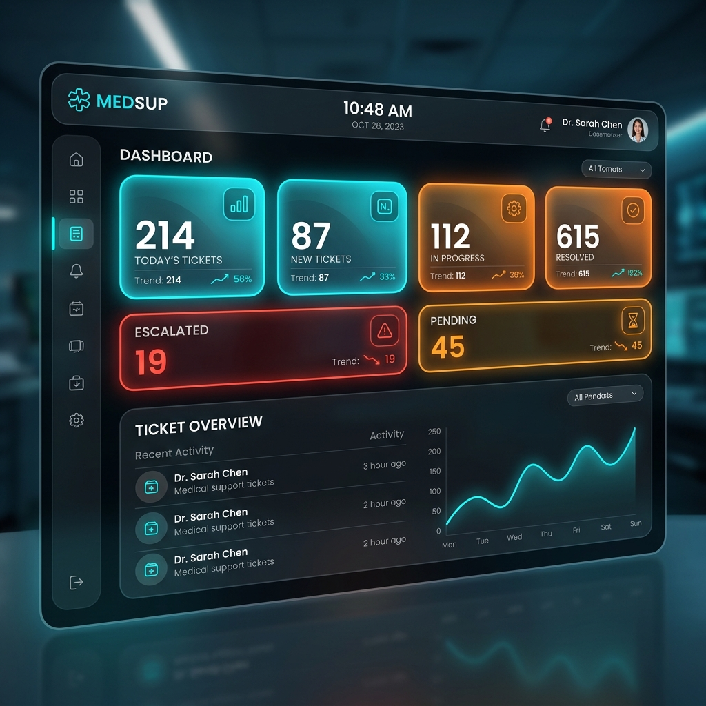
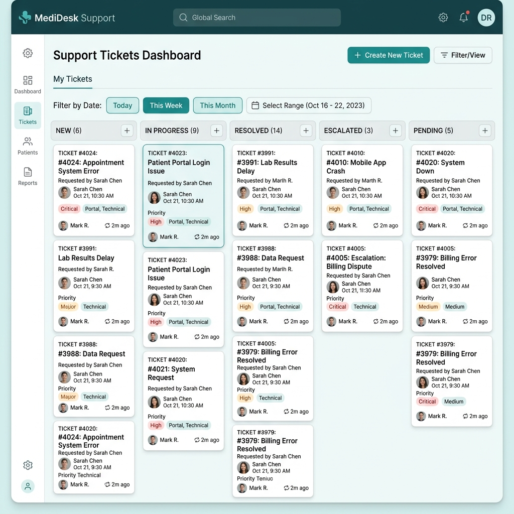
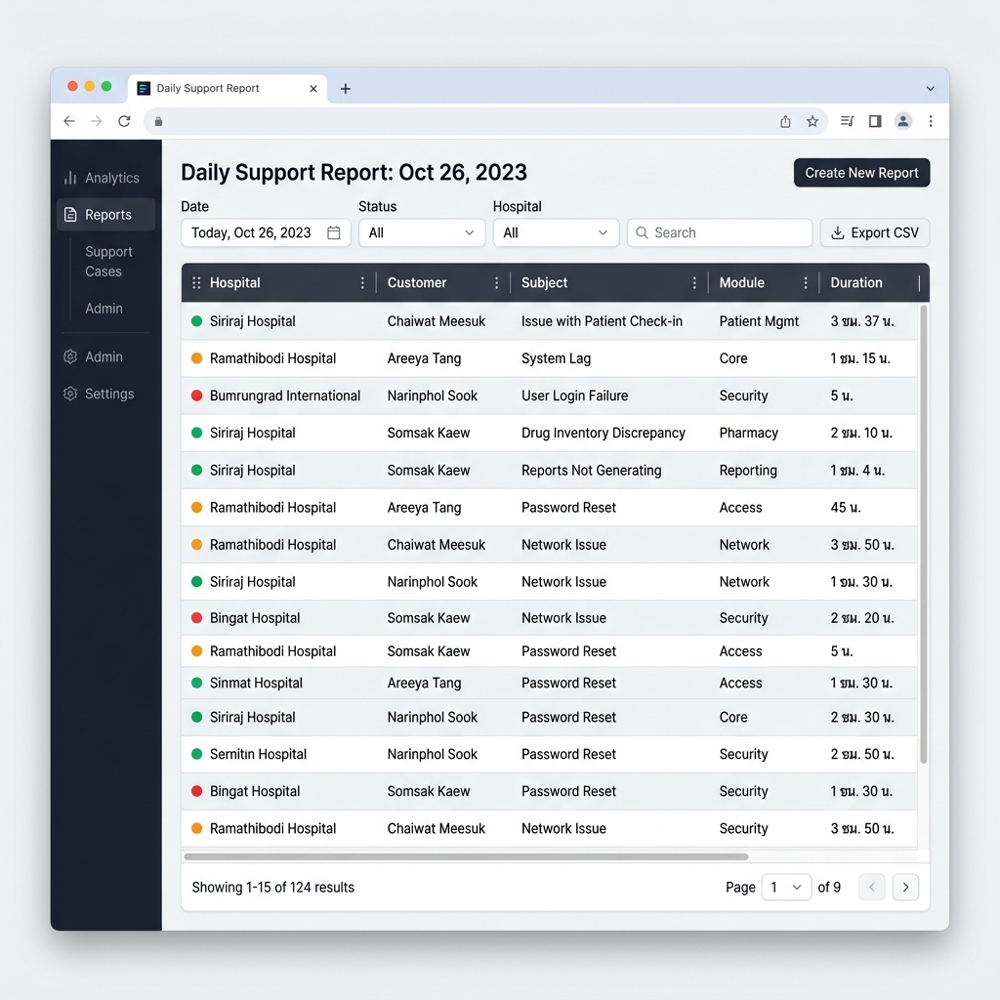

# 📘 คู่มือการใช้งานระบบ NeoSupport Intelligence Suite (Staff Edition)

ยินดีต้อนรับสู่ระบบจัดการปัญหาอัจฉริยะ **NeoSupport** คู่มือฉบับนี้จะช่วยให้คุณใช้งานระบบได้อย่างเต็มประสิทธิภาพ ตั้งแต่การดูภาพรวมสถิติไปจนถึงการจัดการใบงานและส่งรายงานครับ

---

## 1. 📘 ภาพรวมเมนูและการนำทาง (Navigation Guide)
ระบบแบ่งเมนูการใช้งานออกเป็น 3 ส่วนหลักทางด้านซ้าย (Sidebar):

*   **Operations (ฝ่ายปฏิบัติการ):**
    *   **จัดการใบงาน:** หน้าหลักสำหรับติดตามและแก้ไขปัญหา (Ticket Workspace)
    *   **ห้องแชทลูกค้า:** พื้นที่สำหรับสนทนากับลูกค้าผ่าน LINE แบบ Real-time
    *   **การแจ้งเตือน:** ศูนย์รวมเหตุการณ์สำคัญที่เกิดขึ้นในระบบ
*   **Intelligence (ข้อมูลอัจฉริยะ):**
    *   **แดชบอร์ดและสถิติ:** ภาพรวมประสิทธิภาพการทำงานและสถิติสะสม
    *   **ภาพรวมระบบ:** ข้อมูลสรุปเชิงลึกสำหรับผู้บริหาร
    *   **รายงานประจำวัน:** ระบบสรุปผลและส่งรายงานไปยังกลุ่ม LINE
*   **System (ตั้งค่าระบบ):**
    *   **จัดการพนักงาน:** เพิ่ม/ลด หรือกำหนดสิทธิ์การเข้าถึงของทีมงาน
    *   **ข้อมูลพื้นฐาน (Master):** ตั้งค่ารายชื่อโรงพยาบาล, แผนก, และหัวข้อปัญหา

---

## 2. 📘 คู่มือการใช้งาน Dashboard ใหม่ (Executive Summary)
หน้าแรกของระบบที่คุณจะพบเมื่อเข้าใช้งาน ออกแบบมาเพื่อการตัดสินใจที่รวดเร็ว:

### 📊 การอ่านค่า KPI หลัก:
1.  **ใบงานวันนี้:** จำนวนงานทั้งหมดที่เกิดขึ้นในวันนี้ (แสดง % เปรียบเทียบกับเมื่อวาน)
2.  **ใบงานใหม่:** งานที่ยังไม่มีเจ้าหน้าที่รับดำเนินการ (Status: New)
3.  **กำลังดำเนินงาน:** งานที่เจ้าหน้าที่รับเข้าเครื่องแล้ว (Status: In Progress)
4.  **ปิดงานแล้ว:** งานที่แก้ไขสำเร็จและปิดเคสเรียบร้อย (Status: Resolved/Closed)

### ⚠️ ช่องสถานะพิเศษ (Compact Cards):
*   **ส่งต่อ (Escalated):** (แถบสีแดง) จำนวนงานที่ถูกส่งต่อไปยังหน่วยงานอื่นและยังไม่ได้รับการตอบกลับ
*   **รอดำเนินการ (Pending):** (แถบสีส้ม) จำนวนงานที่เจ้าหน้าที่รับทราบแล้วแต่กำลังรอข้อมูลเพิ่มเติม

---

## 3. 📋 การจัดการ Ticket Workspace (Workflow Management)
หน้านี้คือ "หัวใจ" ของการทำงานประจำวัน:

### 📅 การใช้ตัวกรองช่วงเวลา (Time Filter):
*   **วันนี้:** ดูเฉพาะงานที่เกิดขึ้นในรอบ 24 ชั่วโมงนี้
*   **สัปดาห์นี้:** ดูงานตั้งแต่วันจันทร์ที่ผ่านมาจนถึงปัจจุบัน
*   **เดือนนี้:** ดูงานตั้งแต่วันที่ 1 ของเดือนปัจจุบัน

### 💡 เคล็ดลับงานค้าง:
*   ใบงานในช่อง **"ส่งต่อ (Escalated)"** และ **"รอดำเนินการ (Pending)"** จะ **แสดงค้างอยู่เสมอ** แม้คุณจะเปลี่ยน Filter เป็น "วันนี้" ก็ตาม เพื่อความต่อเนื่องในการทำงานครับ

---

## 4. 📈 คู่มือการดูและส่งออกรายงาน (Reporting Hub)
ระบบรายงานประจำวันที่ออกแบบมาเพื่อความคล่องตัว:

### 🖱️ การจัดการตารางรายงาน:
*   **ลากปรับความกว้าง:** คุณสามารถนำเมาส์ไปวางที่ "เส้นแบ่งคอลัมน์" แล้วลากเพื่อขยายหรือย่อความกว้างได้ทันที
*   **การอ่านตัวย่อเวลา:** ระบบจะแสดงผลแบบย่อ เช่น `3 ชม. 37 น.` (3 ชั่วโมง 37 นาที) เพื่อความกระชับครับ

---
*จัดทำโดย: Documentation Writer Agent (NeoSupport Intelligence Suite)*
